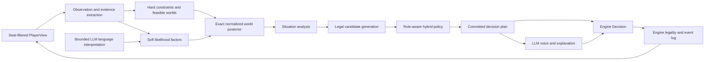

# Probabilistic agent architecture

**Status:** target design. This document defines where AvaLLM's agent architecture should go. It is
not a description of what every current code path already does.

Companions:

- [research-probabilistic-agents.md](research-probabilistic-agents.md) records the external
  research and its evidentiary limits.
- [agent-architecture-migration.md](agent-architecture-migration.md) tracks the work from the
  current implementation to this design.
- [design-bot-guidance.md](design-bot-guidance.md) remains the reference for current prompt
  guidance and forced-play rules.
- [design-implementation.md](design-implementation.md) remains the reference for the engine,
  server, client, and existing agent boundary.

---

## 1. Decision

AvaLLM should make the production bot a composed **hybrid agent**, not an LLM with an increasingly
large strategy prompt.

The hybrid agent has six distinct responsibilities:

1. **Observation:** convert a seat-filtered `PlayerView` into typed evidence.
2. **Constraint:** enumerate complete hidden worlds that remain possible.
3. **Belief:** weight those worlds using mechanical, behavioral, and bounded language evidence.
4. **Analysis:** derive the board quantities that decisions actually need.
5. **Policy:** choose a legal action using beliefs, strategic objectives, and forced-play rules.
6. **Voice:** express the committed plan in the selected model and persona's language.

The exact-world model is the initial inference backend. Evidence is expressed as composable
factors, but AvaLLM should not initially use a factor-graph library or belief propagation. The
hidden state is small enough to enumerate, and exact enumeration preserves the correlations that
team decisions depend on.

The existing pure engine, `viewFor` hidden-information boundary, event log, and pluggable
`AvalonAgent` concept remain. The internals of the LLM and heuristic agents are expected to change
substantially.

---

## 2. Goals and non-goals

### 2.1 Goals

- Produce agents that are strategically competent, socially coherent, and enjoyable to play
  against.
- Make deductions reproducible and inspectable rather than dependent on an LLM re-deriving the
  record every turn.
- Preserve joint uncertainty over complete role assignments.
- Give proposals, votes, quest cards, discussion, and assassination one shared belief state.
- Support every legal AvaLLM player count, role set, and alignment.
- Keep mechanical truth, uncertain inference, strategic policy, and public speech separate.
- Allow better likelihood models, policies, and search to be added without rewriting prompts or
  the game engine.
- Preserve raw-LLM, heuristic, and random agents as baselines for evaluation.
- Attribute every belief change and decision to versioned evidence and policy components.

### 2.2 Non-goals

- Reimplement GRAIL's six-player factor graph.
- Require neural training, CFR, or MCTS before the first useful agent.
- Treat the highest-probability hidden world as known truth.
- Make every role optimize the same objective.
- Turn the LLM into a passive text formatter. It should still interpret language, form social
  plans, choose among strategically reasonable alternatives, and provide the character of play.
- Move private inference into `PlayerView` or the game engine.

---

## 3. Invariants

These constraints apply to every implementation of this architecture.

### 3.1 Hidden information

- All cognition starts from `PlayerView`, never raw `Game`.
- `viewFor(game, seat)` remains the only hidden-information chokepoint.
- Runtime inference may use only the events and private knowledge visible to that seat.
- Offline evaluators may join beliefs with the true deal only after the decision has been
  recorded.
- Public-observer models must use a public projection of the view. They must not accidentally
  incorporate the observing agent's private knowledge.

### 3.2 Probability

- Hard constraints may remove a world.
- Soft evidence may reweight a feasible world.
- Soft evidence can never restore an impossible world.
- A displayed probability always names its semantics and model version. A uniform share of
  feasible hypotheses is not presented as calibrated behavioral probability.
- Team quantities are derived from the joint distribution, not by multiplying independent player
  suspicion scores.

### 3.3 Decisions

- Engine legality is final and remains independent of the agent.
- Forced plays are executable policy rules with tests. Prompt prose may explain them but is not
  their only implementation.
- A proposal or revision is committed before its public explanation is generated.
- Public speech may explain or disguise a plan within the role's strategy, but it may not silently
  change the selected action.
- An agent's own prior actions are not evidence for its private hidden-world posterior. They are
  evidence in the separate model of what public observers may believe.

### 3.4 Reproducibility

- Deterministic components use the game seed and stable event sequence numbers.
- Every soft factor, policy, language interpreter, and prompt has a version.
- Belief snapshots record the last processed event and evidence provenance.
- Replaying the same seat view through the same component versions produces the same mechanical
  evidence and posterior.

---

## 4. Target flow



The arrows describe data ownership, not necessarily one model call per box. Mechanical layers
should be cheap and deterministic. Language interpretation should run only when new table talk
justifies it. Voice runs only when a public utterance is needed.

---

## 5. Core domain types

The exact TypeScript names may change during implementation. The important decision is that these
concepts are explicit and do not collapse into a prompt string.

### 5.1 Evidence

```ts
type EvidenceScope = 'private' | 'public'
type EvidenceStrength = 'hard' | 'soft'

interface Evidence {
  id: string
  throughSeq: number
  scope: EvidenceScope
  strength: EvidenceStrength
  kind:
    | 'deal'
    | 'privateKnowledge'
    | 'proposal'
    | 'voteReveal'
    | 'questResult'
    | 'utterance'
    | 'commitment'
  actor?: Seat
  payload: unknown
}
```

Evidence extraction consumes typed `PlayerView` fields and visible events. It never parses the
rendered facts dossier or prompt text. Prompt rendering is a downstream presentation of the same
facts.

Mechanical evidence includes role counts, private visibility, proposals, votes, quest teams, and
Fail counts. Language evidence is a structured interpretation with source attribution; it is not
free-form scratchpad prose.

### 5.2 Hidden worlds

```ts
interface HiddenWorld {
  roleBySeat: readonly Role[]
  alignmentBySeat: readonly Alignment[]
  key: string
}
```

A world is a complete assignment of the public role multiset to seats. Canonical generation handles
duplicate Servant or Minion roles without producing duplicate worlds.

The first implementation may use a compact alignment projection for good/evil team decisions. The
public abstraction is still a complete hidden world so that Merlin, Morgana, Percival, Mordred,
Oberon, and assassination posteriors can be added without changing every consumer.

### 5.3 Factors and posterior

```ts
interface LikelihoodFactor {
  id: string
  version: string
  supports(evidence: Evidence): boolean
  logLikelihood(
    world: HiddenWorld,
    evidence: Evidence,
    context: InferenceContext,
  ): number
}

interface WeightedWorld {
  world: HiddenWorld
  probability: number
}

interface BeliefSnapshot {
  throughSeq: number
  modelVersion: string
  worlds: readonly WeightedWorld[]
  playerMarginals: readonly PlayerMarginal[]
  roleMarginals: readonly RoleMarginal[]
  entropy: number
  provenance: readonly EvidenceContribution[]
  quality: 'constraints-only' | 'weighted' | 'degraded'
  degradation: readonly string[]
}
```

For feasible world \(w\) and evidence \(E\):

\[
P(w \mid E) \propto I[w\text{ feasible}]P_0(w)\prod_i \phi_i(w,E_i)
\]

Implementation should accumulate log likelihoods and normalize with log-sum-exp.
The landed projection kernel normalizes arbitrary positive feasible-world weights and is shared by
constraints-only and weighted models. Every downstream marginal, joint team quantity, entropy
value, and decision feature consumes those weights. Constraints-only snapshots retain exact
uniform arithmetic so frozen prompts and fixtures do not drift.

Initial factors should be transparent:

- exact role multiset;
- own role and private visibility;
- quest Fail-count feasibility;
- quest-card behavior;
- proposal behavior;
- approval behavior;
- bounded language evidence.

The first three can be implemented without training. The behavioral factors should begin as
versioned, conservative tables or small regressions and must expose calibration metrics before
their influence is increased.

### 5.4 Situation analysis

```ts
interface TeamAssessment {
  team: readonly Seat[]
  cleanProbability: number
  evilCountDistribution: readonly number[]
  questSuccessProbability: number
  expectedInformationGain?: number
}

interface SituationAnalysis {
  throughSeq: number
  score: { good: number; evil: number }
  matchPoint: { good: boolean; evil: boolean }
  proposalsRemaining: number
  currentTeam?: TeamAssessment
  candidateTeams: readonly TeamAssessment[]
  knownGood: readonly Seat[]
  knownEvil: readonly Seat[]
  unresolved: readonly Seat[]
  publicObserver?: ObserverSnapshot
  assassinTargets?: readonly TargetAssessment[]
}
```

This layer is the only source for decision-ready summaries. It replaces repeated arithmetic in
prompts and prevents each policy from inventing a different definition of "safe team."

### 5.5 Persistent cognition

```ts
interface CognitionState {
  throughSeq: number
  evidence: readonly Evidence[]
  beliefs: BeliefSnapshot
  commitments: readonly Commitment[]
  languageReads: readonly LanguageEvidence[]
  socialModels: readonly SocialModel[]
  currentPlan?: DecisionPlan
}
```

`CognitionState` replaces the current scratchpad as authoritative memory. A short natural-language
private note may remain for model continuity and post-game entertainment, but no rule, belief, or
commitment exists only in that note.

Commitments record what the agent publicly supported, opposed, claimed, and promised. They allow
the policy to distinguish intentional deception from accidental incoherence.

### 5.6 Decision plan

```ts
interface DecisionPlan {
  request: DecisionRequest
  decision: Decision
  policyId: string
  reasons: readonly ReasonCode[]
  beliefThroughSeq: number
  candidateScores?: readonly CandidateScore[]
  communication?: CommunicationIntent
}
```

The policy commits this plan before the voice layer runs. `CommunicationIntent` can specify the
claim to advance, facts safe to cite, facts to conceal, desired lean, target players, and tone. The
LLM turns that intent into natural table talk.

---

## 6. Belief model

### 6.1 Hard feasibility

The world enumerator applies:

- the exact `rolesInPlay` multiset;
- the viewing seat's own role;
- Merlin's visible evil set and possible Mordred omission;
- evil partner knowledge and possible Oberon omission;
- Percival's Merlin/Morgana candidate pair;
- every resolved quest's minimum evil count implied by its Fail count.

The current `roleCertainties` implementation is a useful, well-tested source of constraint rules.
It computes sound per-seat possibility sets and cardinality closure. The target world model should
reuse those rules or their tests, but its authoritative output is a set of **joint assignments**.
Independent possible-role sets cannot express "exactly one of these two seats is evil."

### 6.2 Exact inference first

At ten players, fixing a good viewer leaves at most `C(9, 4) = 126` alignment assignments. Full
special-role assignments are larger but still tractable for the standard casts, and projections
can avoid paying for role distinctions irrelevant to a decision.

Exact normalized enumeration gives:

- coherent player and role marginals;
- the probability that an entire team is clean;
- an evil-count distribution for the team;
- correlations among seats;
- entropy and information gain;
- samples for shallow counterfactual evaluation.

These are more useful to policy than a single maximum-likelihood assignment.

### 6.3 Factor semantics without a factor graph

AvaLLM should adopt the useful modeling idea from GRAIL: separate hard constraints, learned game
evidence, and bounded language evidence. It should not copy GRAIL's initial inference machinery.

The released GRAIL graph uses six dense neural factors. Each player-role factor consumes essentially
the full flattened quest history, and the graph reconciles those overlapping scores with an
exact-two-evil constraint using loopy max-product belief propagation. AvaLLM instead needs:

- five through ten players;
- configurable special roles;
- good and evil policies;
- exact joint team quantities;
- provenance suitable for debugging;
- no required Python or PyTorch runtime.

The `LikelihoodFactor` interface keeps a future graph backend possible. If hidden state later
includes persistent player traits, nested beliefs for every seat, or enough latent variables that
enumeration becomes expensive, `FactorGraphBeliefModel` can replace `ExactWorldBeliefModel` behind
the same contract.

### 6.4 Mechanical likelihoods

Quest outcomes require a model of evil card choice. A succeeded quest containing evil is possible,
so success normally reweights rather than eliminates worlds. The model must account for:

- quest number and score;
- team size and Fails required;
- number of evil players aboard;
- whether those evil players know one another;
- slow-play conventions;
- decisive-board behavior.

Proposal and vote factors must also be contextual. Approving a team on proposal one is not the same
event as approving it near the hammer. Factors should be conservative until measured against
held-out games from the opponent populations AvaLLM actually uses.

### 6.5 Language likelihoods

The LLM language interpreter receives new attributed utterances plus the current public record. It
returns a small schema such as:

```ts
interface LanguageEvidence {
  sourceSeqs: readonly number[]
  subject: Seat
  direction: 'moreEvil' | 'moreGood' | 'unchanged'
  class:
    | 'contradiction'
    | 'unsupportedCertainty'
    | 'coalitionDefense'
    | 'truthTracking'
    | 'roleKnowledgeTell'
    | 'other'
  confidence: 'low' | 'medium' | 'high'
  publicRationale: string
  interpreterVersion: string
}
```

The inference layer maps this finite output to capped likelihood ratios. Caps are weaker early,
stronger only after validation, and lower than hard mechanical evidence. Multiple descriptions of
the same utterance are deduplicated by source sequence so one statement is not counted repeatedly.

---

## 7. Policy architecture

Belief and policy are separate. The posterior describes what may be true; policy chooses what this
role wants to do about it.

### 7.1 Policy order

1. Generate legal candidates.
2. Apply forced-play rules that dominate strategic discretion.
3. Compute role-specific candidate features and expected values.
4. Remove clearly dominated candidates.
5. Choose among the remaining candidates using the configured policy.
6. Commit a `DecisionPlan`.
7. Generate any public explanation from that plan.

### 7.2 Policy modes

- **Structured:** deterministic or stochastic code chooses from candidate values. Useful as a
  strong, cheap baseline and fallback.
- **Hybrid:** code enforces forced plays and supplies a bounded candidate set; the LLM planner may
  choose among strategically viable candidates and set the social intent. This should become the
  production default.
- **Raw LLM:** the LLM receives the view and decides directly. Retained as a research baseline for
  measuring the value of the architecture.

An LLM planner choice is still structured output referencing candidate IDs. It does not regenerate
arbitrary teams or cards in prose.

### 7.3 Role objectives

- **Servant:** maximize quest win probability while preserving enough information to identify safe
  teams.
- **Merlin:** trade off quest influence against public conspicuousness and assassination risk.
- **Percival:** infer the Merlin/Morgana pair while increasing its own value as an Assassin decoy.
- **Evil:** trade off quest failure, cover, teammate coordination, and information about Merlin.
- **Mordred:** exploit Merlin's uncertainty and observe who treats it anomalously.
- **Oberon:** maintain a posterior over unseen teammates and reason explicitly about coordination
  uncertainty.
- **Assassin:** use a separate Merlin posterior and endgame target value, not a generic "most good"
  score.

These objectives share facts and beliefs but should not be compressed into one universal score.

---

## 8. Voice and model identity

The model remains a visible part of AvaLLM's appeal. Architecture should separate:

- **brain:** belief model, factors, analysis, and policy;
- **model:** the LLM used for interpretation, planning, and speech;
- **persona:** table manner and rhetorical style;
- **strategy pack:** optional role or kind guidance;
- **difficulty:** factor strength, policy quality, search budget, and model tier.

Changing a persona must not erase beliefs. Changing the model should not silently change forced
plays. Two agents can share a brain but feel different because their planners and voices differ.
Conversely, two agents can share a model while playing at different strategic levels.

Prompt construction becomes a renderer over typed cognition:

```text
rules and role
+ selected private knowledge
+ belief and situation summary
+ current commitments and plan
+ recent attributed table talk
+ communication task and output contract
```

The prompt is no longer the authoritative database of strategy or memory.

---

## 9. Agent boundary and telemetry

Phase 3 introduced a compatibility boundary where legacy agents may still return a bare engine
`Decision` and composed agents return `AgentDecision`; runners normalize that transitional
`AgentOutput` union. The target boundary remains envelope-only, allowing agent-owned trace data
without adding cognition concepts to the pure engine:

```ts
interface AgentDecision {
  decision: Decision
  trace?: DecisionTrace
}

interface AvalonAgent {
  decide(req: DecisionRequest, view: PlayerView): Promise<AgentDecision>
  dispose?(): void
}
```

The runner unwraps `decision` for `applyDecision` and records an envelope trace only after the
engine accepts that action. `DecisionTrace` can contain component versions, posterior summaries,
candidate scores, degradation state, and token cost. It must never enter another live player's
view. The bare-decision branch is a migration aid, not the final plugin contract.

Legacy agents can be adapted with `{ decision }`. External stdio agents should gain the trace field
only as an optional protocol extension.

---

## 10. Failure and degradation

The game must still never stall.

1. If language interpretation fails, retain the previous structured state and process mechanical
   evidence.
2. If a soft factor fails, omit that factor and mark the snapshot degraded.
3. If weighted inference fails, fall back to a uniform distribution over feasible worlds.
4. If world enumeration fails, fall back to the existing tested heuristic agent.
5. If planning or voice fails, use the structured policy's committed decision and a silent or
   canned utterance.
6. If the final decision is illegal, the runner retains the existing heuristic fallback.

Each step is surfaced in trace data. A belief failure and a malformed-output failure are different
degradation classes.

---

## 11. Recommended module ownership

```text
server/agents/
  cognition/
    observation.ts
    evidence.ts
    state.ts
    commitments.ts
  belief/
    worlds.ts
    constraints.ts
    exact.ts
    projections.ts
    factors/
      quest.ts
      proposal.ts
      vote.ts
      language.ts
  analysis/
    board.ts
    teams.ts
    observer.ts
    assassination.ts
  policy/
    candidates.ts
    forced.ts
    structured.ts
    hybrid.ts
    objectives/
  communication/
    interpreter.ts
    intent.ts
    prompts.ts
    voice.ts
  agents/
    hybrid.ts
    raw-llm.ts
    heuristic.ts
```

This is an ownership map, not a requirement to create every file immediately. The important
boundaries are:

- evidence does not choose actions;
- belief does not render prompts;
- policy does not read raw `Game`;
- voice does not change committed actions;
- evaluation observes traces but runtime cognition never reads evaluation truth.

---

## 12. Evaluation contract

Every meaningful architecture stage must be independently ablatable:

- current prompt-guided LLM;
- hard constraints only;
- exact hypotheses plus structured policy;
- mechanical likelihood factors;
- bounded language factors;
- hybrid LLM planner;
- observer and role-specific models;
- shallow search.

Required metrics are defined in
[research-probabilistic-agents.md §7](research-probabilistic-agents.md#7-evaluation-requirements).
In addition, architecture tests should cover:

- permutation invariance;
- identical replay from the same view and versions;
- no impossible world receiving weight;
- no language evidence restoring an impossible world;
- no private evidence entering the public-observer model;
- no own-action self-confirmation in the private posterior;
- proposal explanation matching the committed team;
- legal fallback at every degradation layer.

Win rate decides whether an agent is useful, but calibration and behavioral metrics explain why.

---

## 13. Decisions deliberately deferred

- Whether full role worlds or alignment worlds are the default stored representation.
- The first parameterization of proposal and vote likelihoods.
- Whether the hybrid planner chooses one candidate or ranks several for a structured tie-break.
- How much observer modeling runs online versus only at Merlin and evil decision points.
- Whether cognition traces are stored in the game artifact or a sidecar artifact.
- When exact enumeration becomes expensive enough to justify variable elimination, sampling, or a
  factor graph.

These choices do not change the component boundaries above.
