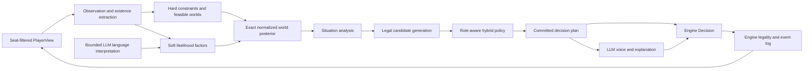

# Probabilistic agent architecture

**Status:** target design. This document defines where AvaLLM's agent architecture should go. It is
not a description of what every current code path already does.

Companions:

- [research-probabilistic-agents.md](research-probabilistic-agents.md) records the external
  research and its evidentiary limits.
- [agent-architecture-migration.md](agent-architecture-migration.md) tracks the work from the
  current implementation to this design.
- [design-bot-guidance.md](design-bot-guidance.md) remains the reference for current prompt
  guidance and forced-play rules.
- [design-implementation.md](design-implementation.md) remains the reference for the engine,
  server, client, and existing agent boundary.

---

## 1. Decision

AvaLLM should make the production bot a composed **hybrid agent**, not an LLM with an increasingly
large strategy prompt.

The hybrid agent has six distinct responsibilities:

1. **Observation:** convert a seat-filtered `PlayerView` into typed evidence.
2. **Constraint:** enumerate complete hidden worlds that remain possible.
3. **Belief:** weight those worlds using mechanical, behavioral, and bounded language evidence.
4. **Analysis:** derive the board quantities that decisions actually need.
5. **Policy:** choose a legal action using beliefs, strategic objectives, and forced-play rules.
6. **Voice:** express the committed plan in the selected model and persona's language.

The exact-world model is the initial inference backend. Evidence is expressed as composable
factors, but AvaLLM should not initially use a factor-graph library or belief propagation. The
hidden state is small enough to enumerate, and exact enumeration preserves the correlations that
team decisions depend on.

The existing pure engine, `viewFor` hidden-information boundary, event log, and pluggable
`AvalonAgent` concept remain. The internals of the LLM and heuristic agents are expected to change
substantially.

---

## 2. Goals and non-goals

### 2.1 Goals

- Produce agents that are strategically competent, socially coherent, and enjoyable to play
  against.
- Make deductions reproducible and inspectable rather than dependent on an LLM re-deriving the
  record every turn.
- Preserve joint uncertainty over complete role assignments.
- Give proposals, votes, quest cards, discussion, and assassination one shared belief state.
- Support every legal AvaLLM player count, role set, and alignment.
- Keep mechanical truth, uncertain inference, strategic policy, and public speech separate.
- Allow better likelihood models, policies, and search to be added without rewriting prompts or
  the game engine.
- Preserve raw-LLM, heuristic, and random agents as baselines for evaluation.
- Attribute every belief change and decision to versioned evidence and policy components.

### 2.2 Non-goals

- Reimplement GRAIL's six-player factor graph.
- Require neural training, CFR, or MCTS before the first useful agent.
- Treat the highest-probability hidden world as known truth.
- Make every role optimize the same objective.
- Turn the LLM into a passive text formatter. It should still interpret language, form social
  plans, choose among strategically reasonable alternatives, and provide the character of play.
- Move private inference into `PlayerView` or the game engine.

---

## 3. Invariants

These constraints apply to every implementation of this architecture.

### 3.1 Hidden information

- All cognition starts from `PlayerView`, never raw `Game`.
- `viewFor(game, seat)` remains the only hidden-information chokepoint.
- Runtime inference may use only the events and private knowledge visible to that seat.
- Offline evaluators may join beliefs with the true deal only after the decision has been
  recorded.
- Public-observer models must use a public projection of the view. They must not accidentally
  incorporate the observing agent's private knowledge.

### 3.2 Probability

- Hard constraints may remove a world.
- Soft evidence may reweight a feasible world.
- Soft evidence can never restore an impossible world.
- A displayed probability always names its semantics and model version. A uniform share of
  feasible hypotheses is not presented as calibrated behavioral probability.
- Team quantities are derived from the joint distribution, not by multiplying independent player
  suspicion scores.

### 3.3 Data dependence and priors

The north-star agent is **data-enhanced, not data-dependent**. Its correctness, legality, hard
deductions, and complete structured policy do not require historical Avalon games or an
AvaLLM-trained model. Three probability layers remain distinct:

1. **Rule-derived prior and feasible worlds.** Role counts, the viewer's role and private
   visibility, and hard public constraints come from the current seat-filtered `PlayerView`.
   Canonical assignments may be cached by game configuration for performance, but they are not
   learned behavioral probabilities and contain no game-specific hidden state.
2. **Optional pre-game likelihood bundle.** Versioned factor parameters may be hand-authored or
   calibrated from prior game artifacts and loaded before a game. They describe behavior for a
   named opponent population, such as contextual proposal, vote, or quest-card tendencies. They
   may only reweight feasible worlds, and their data source, factor version, calibration
   population, and caps remain attributable.
3. **Current-game posterior.** During play, the agent combines the rule-derived feasible set,
   optional likelihood parameters, and evidence visible to that seat in the current game. A
   pre-game bundle must not contain a suspicion state, inferred deal, or truth-derived profile for
   the game being played.

Provider LLM pretraining is separate from AvaLLM-specific behavioral calibration. A pretrained LLM
may interpret bounded language, plan among strategically acceptable candidates, and provide voice,
but mechanical belief, forced policy, and engine legality remain complete without it.

Historical data may improve the strongest production configuration, but it must satisfy these
requirements:

- Constraints-only inference plus structured policy remains a complete, independently testable
  agent when every optional factor is absent.
- Training, calibration, and evaluation split by whole game and opponent population. Evaluation
  banks and human-study games never become training rows for the component they evaluate.
- A population mismatch weakens or disables the relevant factor rather than silently treating its
  likelihoods as universal. Unknown players receive a broad population prior. Per-player
  tendencies require adequate samples, shrink toward that population prior, and never infer traits
  from a name or other untrusted identity text.
- Every learned or hand-authored contribution is versioned, capped, attributable, and unable to
  revive an impossible world.
- Missing, stale, or failed factor data degrades to the exact feasible-world posterior and is
  visible in private trace data; it never prevents a legal decision.

The production agent may therefore depend on a calibrated bundle for its measured peak strength,
but not for sound inference, safe operation, or a coherent playable fallback.

### 3.4 Decisions

- Engine legality is final and remains independent of the agent.
- Forced plays are executable policy rules with tests. Prompt prose may explain them but is not
  their only implementation.
- A proposal or revision is committed before its public explanation is generated.
- Public speech may explain or disguise a plan within the role's strategy, but it may not silently
  change the selected action.
- An agent's own prior actions are not evidence for its private hidden-world posterior. They are
  evidence in the separate model of what public observers may believe.

### 3.5 Reproducibility

- Deterministic components use the game seed and stable event sequence numbers.
- Every soft factor, policy, language interpreter, and prompt has a version.
- Belief snapshots record the last processed event and evidence provenance.
- Replaying the same seat view through the same component versions produces the same mechanical
  evidence and posterior.

---

## 4. Target flow



The arrows describe data ownership, not necessarily one model call per box. Mechanical layers
should be cheap and deterministic. Language interpretation should run only when new table talk
justifies it. Voice runs only when a public utterance is needed.

---

## 5. Core domain types

The exact TypeScript names may change during implementation. The important decision is that these
concepts are explicit and do not collapse into a prompt string.

### 5.1 Evidence

```ts
type EvidenceScope = 'private' | 'public'
type EvidenceStrength = 'hard' | 'soft'

interface Evidence {
  id: string
  throughSeq: number
  scope: EvidenceScope
  strength: EvidenceStrength
  kind:
    | 'deal'
    | 'privateKnowledge'
    | 'proposal'
    | 'voteReveal'
    | 'questResult'
    | 'utterance'
    | 'commitment'
  actor?: Seat
  payload: unknown
}
```

Evidence extraction consumes typed `PlayerView` fields and visible events. It never parses the
rendered facts dossier or prompt text. Prompt rendering is a downstream presentation of the same
facts.

Mechanical evidence includes role counts, private visibility, proposals, votes, quest teams, and
Fail counts. Language evidence is a structured interpretation with source attribution; it is not
free-form scratchpad prose.

### 5.2 Hidden worlds

```ts
interface HiddenWorld {
  roleBySeat: readonly Role[]
  alignmentBySeat: readonly Alignment[]
  key: string
}
```

A world is a complete assignment of the public role multiset to seats. Canonical generation handles
duplicate Servant or Minion roles without producing duplicate worlds.

The first implementation may use a compact alignment projection for good/evil team decisions. The
public abstraction is still a complete hidden world so that Merlin, Morgana, Percival, Mordred,
Oberon, and assassination posteriors can be added without changing every consumer.

### 5.3 Factors and posterior

```ts
interface LikelihoodFactor {
  id: string
  version: string
  supports(evidence: Evidence): boolean
  logLikelihood(
    world: HiddenWorld,
    evidence: Evidence,
    context: InferenceContext,
  ): number
}

interface WeightedWorld {
  world: HiddenWorld
  probability: number
}

interface BeliefSnapshot {
  throughSeq: number
  modelVersion: string
  worlds: readonly WeightedWorld[]
  playerMarginals: readonly PlayerMarginal[]
  roleMarginals: readonly RoleMarginal[]
  entropy: number
  provenance: readonly EvidenceContribution[]
  quality: 'constraints-only' | 'weighted' | 'degraded'
  degradation: readonly string[]
}
```

For feasible world \(w\) and evidence \(E\):

\[
P(w \mid E) \propto I[w\text{ feasible}]P_0(w)\prod_i \phi_i(w,E_i)
\]

Implementation should accumulate log likelihoods and normalize with log-sum-exp.
The landed projection kernel normalizes arbitrary positive feasible-world weights and is shared by
constraints-only and weighted models. Every downstream marginal, joint team quantity, entropy
value, and decision feature consumes those weights. Constraints-only snapshots retain exact
uniform arithmetic so frozen prompts and fixtures do not drift.

Initial factors should be transparent:

- exact role multiset;
- own role and private visibility;
- quest Fail-count feasibility;
- quest-card behavior;
- proposal behavior;
- approval behavior;
- bounded language evidence.

The first three can be implemented without training. The behavioral factors should begin as
versioned, conservative tables or small regressions and must expose calibration metrics before
their influence is increased.

The first such implementation is `analytical-quest-card-v1`. It uses only public resolved-quest
card counts and mechanical context, applies a nonzero smoothing mixture, and caps the entire
quest-history contribution at `ln(2)`. It never changes the feasible-world set: exact constraints
remain authoritative and the factor only redistributes probability within that set. Its private
snapshot and decision trace identify the factor version, source event sequences, capped
contribution, and any typed degradation. It remains opt-in after its initial held-out success
because the composed policy has not yet beaten the compatibility agent on absolute win rate.
Its calibration improvement survived a deliberately different seeded-random opponent population,
but that is a sensitivity check rather than evidence that its hand-authored likelihoods describe
humans or particular language models.

### 5.4 Situation analysis

```ts
interface TeamAssessment {
  team: readonly Seat[]
  cleanProbability: number
  evilCountDistribution: readonly number[]
  questSuccessProbability: number
  expectedInformationGain?: number
}

interface SituationAnalysis {
  throughSeq: number
  score: { good: number; evil: number }
  matchPoint: { good: boolean; evil: boolean }
  proposalsRemaining: number
  currentTeam?: TeamAssessment
  candidateTeams: readonly TeamAssessment[]
  knownGood: readonly Seat[]
  knownEvil: readonly Seat[]
  unresolved: readonly Seat[]
  publicObserver?: ObserverSnapshot
  assassinTargets?: readonly TargetAssessment[]
}
```

This layer is the only source for decision-ready summaries. It replaces repeated arithmetic in
prompts and prevents each policy from inventing a different definition of "safe team."

### 5.5 Persistent cognition

```ts
interface CognitionState {
  throughSeq: number
  evidence: readonly Evidence[]
  beliefs: BeliefSnapshot
  commitments: readonly Commitment[]
  languageReads: readonly LanguageEvidence[]
  socialModels: readonly SocialModel[]
  currentPlan?: DecisionPlan
}
```

`CognitionState` replaces the current scratchpad as authoritative memory. A short natural-language
private note may remain for model continuity and post-game entertainment, but no rule, belief, or
commitment exists only in that note.

Commitments record what the agent publicly supported, opposed, claimed, and promised. They allow
the policy to distinguish intentional deception from accidental incoherence.

### 5.6 Decision plan

```ts
interface DecisionPlan {
  request: DecisionRequest
  decision: Decision
  policyId: string
  reasons: readonly ReasonCode[]
  beliefThroughSeq: number
  candidateScores?: readonly CandidateScore[]
  communication?: CommunicationIntent
}
```

The policy commits this plan before the voice layer runs. `CommunicationIntent` can specify the
claim to advance, facts safe to cite, facts to conceal, desired lean, target players, and tone. The
LLM turns that intent into natural table talk.

### 5.7 Decision components and resolved brains

Role observers, private objectives, score projections, and strategic decision rules are versioned
**decision components**, not optional fields added to central scorer or trace types one role at a
time. A component declares:

- the decision kinds and roles to which it applies;
- its required upstream components and typed inputs;
- the private tagged payload or policy transformation it produces;
- its version, deterministic seed domain, degradation behavior, and admission rules.

The exact interface names are deliberately not fixed here. The durable contract is that a new role
can be implemented by registering a component and, when it has decision authority, its policy layer
without adding a role-named field to the composed-agent host, common candidate score, common scorer
context, trace envelope, stdio transport, artifact manifest, or evaluator.

Configuration and execution have different representations. Configuration names requested
components and modes. At construction time, a typed resolved brain freezes the requested and
eligible component graph, versions, dependencies, layer order, and compatibility projections for
one agent construction. Runtime options supply operational dependencies such as the game seed,
planner and voice implementations, trace sinks, and clocks or clients where permitted; they do not
become a second source of component configuration. The resolved brain remains immutable across its
decisions.

Each `DecisionRequest` and seat-filtered `PlayerView` then determines which components are
applicable and execute for that decision. Traces preserve all three distinctions: configured
entries show construction-time intent; resolved or admitted decision entries show outputs
successfully admitted into typed cognition; separate policy attribution records whether an
admitted output causally transformed candidate scores or selected an action. A mechanically inert
observer or objective therefore receives a resolved decision entry even though it has no policy
use. Component payloads are tagged by component identity, version, kind, and privacy rather than
stored in unrelated role-specific fields. Private cognition remains private even when the
component metadata is included in an artifact manifest.

Admission belongs to the component boundary. Runtime, stdio, architecture-bank generation, stored
report replay, and artifact validation invoke the same registered reconstruction and validation
rules instead of independently mirroring each component's equations. Admission distinguishes an
exact host-reconstructable result from a structurally valid result whose weighted-world source
cannot be verified from the trace. The latter may remain useful for live execution and diagnostics,
but it is not promotion evidence.

---

## 6. Belief model

### 6.1 Hard feasibility

The world enumerator applies:

- the exact `rolesInPlay` multiset;
- the viewing seat's own role;
- Merlin's visible evil set and possible Mordred omission;
- evil partner knowledge and possible Oberon omission;
- Percival's Merlin/Morgana candidate pair;
- every resolved quest's minimum evil count implied by its Fail count.

The current `roleCertainties` implementation is a useful, well-tested source of constraint rules.
It computes sound per-seat possibility sets and cardinality closure. The target world model should
reuse those rules or their tests, but its authoritative output is a set of **joint assignments**.
Independent possible-role sets cannot express "exactly one of these two seats is evil."

### 6.2 Exact inference first

At ten players, fixing a good viewer leaves at most `C(9, 4) = 126` alignment assignments. Full
special-role assignments are larger but still tractable for the standard casts, and projections
can avoid paying for role distinctions irrelevant to a decision.

Exact normalized enumeration gives:

- coherent player and role marginals;
- the probability that an entire team is clean;
- an evil-count distribution for the team;
- correlations among seats;
- entropy and information gain;
- samples for shallow counterfactual evaluation.

These are more useful to policy than a single maximum-likelihood assignment.

### 6.3 Factor semantics without a factor graph

AvaLLM should adopt the useful modeling idea from GRAIL: separate hard constraints, learned game
evidence, and bounded language evidence. It should not copy GRAIL's initial inference machinery.

The released GRAIL graph uses six dense neural factors. Each player-role factor consumes essentially
the full flattened quest history, and the graph reconciles those overlapping scores with an
exact-two-evil constraint using loopy max-product belief propagation. AvaLLM instead needs:

- five through ten players;
- configurable special roles;
- good and evil policies;
- exact joint team quantities;
- provenance suitable for debugging;
- no required Python or PyTorch runtime.

The `LikelihoodFactor` interface keeps a future graph backend possible. If hidden state later
includes persistent player traits, nested beliefs for every seat, or enough latent variables that
enumeration becomes expensive, `FactorGraphBeliefModel` can replace `ExactWorldBeliefModel` behind
the same contract.

### 6.4 Mechanical likelihoods

Quest outcomes require a model of evil card choice. A succeeded quest containing evil is possible,
so success normally reweights rather than eliminates worlds. The model must account for:

- quest number and score;
- team size and Fails required;
- number of evil players aboard;
- whether those evil players know one another;
- slow-play conventions;
- decisive-board behavior.

Proposal and vote factors must also be contextual. Approving a team on proposal one is not the same
event as approving it near the hammer. Factors should be conservative until measured against
held-out games from the opponent populations AvaLLM actually uses.

### 6.5 Language likelihoods

The LLM language interpreter receives new attributed utterances plus the current public record. It
returns a small schema such as:

```ts
interface LanguageEvidence {
  sourceSeqs: readonly number[]
  subject: Seat
  direction: 'moreEvil' | 'moreGood' | 'unchanged'
  class:
    | 'contradiction'
    | 'unsupportedCertainty'
    | 'coalitionDefense'
    | 'truthTracking'
    | 'roleKnowledgeTell'
    | 'other'
  confidence: 'low' | 'medium' | 'high'
  publicRationale: string
  interpreterVersion: string
}
```

The inference layer maps this finite output to capped likelihood ratios. Caps are weaker early,
stronger only after validation, and lower than hard mechanical evidence. Multiple descriptions of
the same utterance are deduplicated by source sequence so one statement is not counted repeatedly.

---

## 7. Policy architecture

Belief and policy are separate. The posterior describes what may be true; policy chooses what this
role wants to do about it.

### 7.1 Policy order

1. Generate legal candidates.
2. Apply universal forced-play rules that dominate strategic discretion.
3. Compute the shared base candidate features and expected values.
4. Apply configured score-policy layers in explicit order.
5. Remove clearly dominated candidates.
6. Apply any remaining strategic decision layers that are valid for the unresolved choice.
7. Choose among the remaining candidates using the configured policy.
8. Commit a `DecisionPlan`.
9. Generate any public explanation from that plan.

Score and decision layers transform a typed prior surface. The score surface has one schema
version, while the execution journal's exact layer token identifies the producer; rows do not
carry arbitrary producer versions. Each layer declares its inputs, one applicability predicate,
version, and fallback. Its execution may apply a surface or degrade, but it cannot independently
redeclare itself inapplicable. It may narrow or rank the candidates that survived universal forced
policy, but it cannot revive a removed candidate, mutate the committed engine action, or silently
bypass a stronger shared objective. If a layer is missing, inapplicable, malformed, or degraded,
execution continues from the last valid surface and records that resolution. Analysis
requirements are exposed before analysis through an invocation-local one-shot capability. That
capability verifies the exact resolved brain, delegates once to the sole component transition,
binds its exact returned frame, and may execute only against that frame, without a global
provenance map or second hostile-data parse.

Universal rules and strategic rules remain distinct even when both choose an action directly.
Good always playing Success, evil being unable to sink a quest, and decisive match-point play are
universal forced policy. A role or coordination strategy such as an optional nondecisive evil
quest-card convention runs only after those universal rules leave discretion. Ordered layers make
that precedence executable and independently testable rather than dependent on call-site order.

### 7.2 Policy modes

- **Structured:** deterministic or stochastic code chooses from candidate values. Useful as a
  strong, cheap baseline and fallback.
- **Hybrid:** code enforces forced plays and supplies a bounded candidate set; the LLM planner may
  choose among strategically viable candidates and set the social intent. This should become the
  production default.
- **Raw LLM:** the LLM receives the view and decides directly. Retained as a research baseline for
  measuring the value of the architecture.

An LLM planner choice is still structured output referencing candidate IDs. It does not regenerate
arbitrary teams or cards in prose.

### 7.3 Role objectives

- **Servant:** maximize quest win probability while preserving enough information to identify safe
  teams.
- **Merlin:** trade off quest influence against public conspicuousness and assassination risk.
- **Percival:** infer the Merlin/Morgana pair while increasing its own value as an Assassin decoy.
- **Evil:** share the mechanical objective of quest failure, cover, and future failure capacity.
  This common objective is a substrate, not a substitute for special-role policy.
- **Morgana:** counterfeit Merlin's public behavior and influence Percival's belief while still
  serving the shared evil mechanical objective.
- **Mordred:** exploit Merlin's uncertainty and observe who treats it anomalously.
- **Oberon:** maintain a posterior over unseen teammates and reason explicitly about coordination
  uncertainty.
- **Assassin:** use a separate Merlin posterior and endgame target value, not a generic "most good"
  score.

These objectives share facts and beliefs but should not be compressed into one universal score.
In particular, a role label or descriptive posture that does not causally affect policy is not an
implemented role objective.

The Assassin posterior begins with the exact joint-world mass whose Merlin coordinate is each
seat. It may then apply a small versioned public-behavior model, but the full relative log-weight
span must remain capped at `ln(2)` before normalization. The first model uses only clean-team
proposal rate and vote agreement, evaluated separately in every possible world by simulating what
that world's Merlin sees: all evil except that world's Mordred. The versioned component contract
defines this as a bounded, hand-authored reweighting of the exact prior, not a calibrated role
probability. Those fixed semantics and deferred-input declarations live here rather than as
repeated strings in every payload. Visible evil
therefore retains zero Merlin prior while a seat that might be Oberon from the Assassin's legal
view is not silently removed. Every completed proposal contributes proposal evidence, rejected
proposals retain their revealed votes, and automatic approvals contribute no nonexistent votes.
Trajectory and deliberate-noise features remain deferred until evaluation justifies them.
Role-claim evidence also remains absent until a typed trusted extractor
exists; raw prose, regular-expression claims, and generic language labels are not valid substitutes.

Morgana's public "read as Merlin" feature must keep two different semantics visible. Public Merlin
eligibility is an exact marginal from the public feasible-world model. Proposal and vote
truth-tracking are bounded, deterministic behavior counts and proxies, not likelihoods or role
probabilities, and they must not reweight that public posterior merely by being displayed beside
it. Candidate consistency is computed over Morgana's resolved complete worlds by simulating
Merlin's legal sight in each world: evil except that world's Mordred. This integrates uncertainty
over which partner is Mordred through joint sums and preserves role correlations; multiplying
independent role or alignment marginals is not an acceptable substitute.

Morgana policy is bounded by the shared evil mechanical objective rather than blended into it.
Forced policy filters first, then the maximum D2 role value over the surviving candidates defines
an explicit `0.04` viability band. Counterfeit value may rank candidates only inside that band and
can never revive a candidate removed by forced policy or lying below the D2 floor. Deterministic
mode chooses maximum counterfeit value with canonical ties. Optional seeded variation is confined
to approve versus reject when both votes are in the D2 band and their counterfeit values differ by
at most `0.04`; proposals stay deterministic. Missing, malformed, or inapplicable Morgana evidence
falls back to the matching D2 policy, not directly to compatibility. This preserves shared evil
competence while making the special-role objective genuinely causal and separately attributable.

Mordred policy follows the same bounded-specialization rule without treating its blindness
objective as a probability of action success. Forced policy and the strategic candidate boundary
filter first. The maximum shared D2 evil value over those survivors defines the existing `0.04`
viability band, and Mordred's blindness opportunity may rank only candidates inside it. For a
proposal, action utility is the selected team's bounded opportunity value. For a vote, approve
uses the current team's opportunity and reject uses its complement. These are explicit heuristic
action utilities, not posterior probabilities or independent-marginal products. Deterministic
mode chooses the maximum utility with canonical candidate ties. Optional seeded variation is
confined to approve versus reject when both actions remain inside the D2 band and their Mordred
utility gap is at most `0.04`; proposals remain seed invariant. The seed domain contains only the
game seed, acting seat, decision coordinates, belief event cursor, and scorer version. It contains
no names, roster identities, teammate behavior, or shared coordination convention.

The Mordred layer reads only the admitted private blindness objective. Its public-treatment
dependency arrives through the component graph's transitive closure, so the generic trace can
attribute both inputs without a role-specific field. Missing, malformed, or inapplicable evidence
delegates to the matching deterministic or seeded D2 predecessor. Admitted weighted evidence may
still affect the decision, but its structural rather than exact provenance makes that evaluation
run nonpromotable. Private Mordred reason codes remain mechanical trace evidence and are not
projected into public communication intent. This keeps Merlin-blindness play causal and
inspectable while preserving the shared evil policy, engine legality, and heterogeneous-table
assumptions.

Coordination policy must also be valid for heterogeneous tables containing humans, raw LLMs, and
other agent types. A deployable evil agent cannot assume that teammates share its algorithm,
timing convention, seed, or capability handshake. Independent robust play is therefore the
production direction. An exact-quota convention remains useful as a clearly labeled homogeneous
research ceiling, but it is deliberately not an executable AvaLLM mode. It depends on a shared
pre-game convention that heterogeneous agents and humans cannot be assumed to follow, so its
results are not production or mixed-table promotion evidence.

---

## 8. Voice and model identity

The model remains a visible part of AvaLLM's appeal. Architecture should separate:

- **brain:** belief model, factors, analysis, and policy;
- **model:** the LLM used for interpretation, planning, and speech;
- **persona:** table manner and rhetorical style;
- **strategy pack:** optional role or kind guidance;
- **difficulty:** factor strength, policy quality, search budget, and model tier.

Changing a persona must not erase beliefs. Changing the model should not silently change forced
plays. Two agents can share a brain but feel different because their planners and voices differ.
Conversely, two agents can share a model while playing at different strategic levels.

Prompt construction becomes a renderer over typed cognition:

```text
rules and role
+ selected private knowledge
+ belief and situation summary
+ current commitments and plan
+ recent attributed table talk
+ communication task and output contract
```

The prompt is no longer the authoritative database of strategy or memory.

---

## 9. Agent boundary and telemetry

Phase 3 introduced a compatibility boundary where legacy agents may still return a bare engine
`Decision` and composed agents return `AgentDecision`; runners normalize that transitional
`AgentOutput` union. The target boundary remains envelope-only, allowing agent-owned trace data
without adding cognition concepts to the pure engine:

```ts
interface AgentDecision {
  decision: Decision
  trace?: DecisionTrace
}

interface AvalonAgent {
  decide(req: DecisionRequest, view: PlayerView): Promise<AgentDecision>
  dispose?(): void
}
```

The runner unwraps `decision` for `applyDecision` and records an envelope trace only after the
engine accepts that action. `DecisionTrace` can contain component versions, posterior summaries,
candidate scores, degradation state, and token cost. It must never enter another live player's
view. The bare-decision branch is a migration aid, not the final plugin contract.

Legacy agents can be adapted with `{ decision }`. External stdio agents should gain the trace field
only as an optional protocol extension.

The composed-agent host resolves one typed brain before a decision. That resolved brain owns
component selection, versions, dependency order, score and decision layers, and configured versus
resolved attribution. Operational injection remains separate: a planner, voice adapter, fake
client, seed source, or trace sink can be replaced for testing without changing which brain was
configured.

Transport and evaluation are consumers of component metadata, not parallel policy
implementations. Stdio may carry registered tagged payloads, and artifacts may retain compatibility
projections while older readers are supported, but reconstruction, equation checks, privacy
classification, and promotion eligibility come from the shared component admission owner. New
manifests and reports are derived from resolved component entries rather than extended with another
role-specific array for each feature.

---

## 10. Failure and degradation

The game must still never stall.

1. If language interpretation fails, retain the previous structured state and process mechanical
   evidence.
2. If a soft factor fails, omit that factor and mark the snapshot degraded.
3. If weighted inference fails, fall back to a uniform distribution over feasible worlds.
4. If world enumeration fails, fall back to the existing tested heuristic agent.
5. If planning or voice fails, use the structured policy's committed decision and a silent or
   canned utterance.
6. If the final decision is illegal, the runner retains the existing heuristic fallback.

Each step is surfaced in trace data. A belief failure and a malformed-output failure are different
degradation classes.

---

## 11. Recommended module ownership

```text
server/agents/
  cognition/
    observation.ts
    evidence.ts
    state.ts
    commitments.ts
  belief/
    worlds.ts
    constraints.ts
    exact.ts
    projections.ts
    factors/
      quest.ts
      proposal.ts
      vote.ts
      language.ts
  analysis/
    board.ts
    teams.ts
    observer.ts
    assassination.ts
  policy/
    candidates.ts
    forced.ts
    structured.ts
    hybrid.ts
    objectives/
  communication/
    interpreter.ts
    intent.ts
    prompts.ts
    voice.ts
  agents/
    hybrid.ts
    raw-llm.ts
    heuristic.ts
```

This is an ownership map, not a requirement to create every file immediately. The important
boundaries are:

- evidence does not choose actions;
- belief does not render prompts;
- policy does not read raw `Game`;
- voice does not change committed actions;
- evaluation observes traces but runtime cognition never reads evaluation truth.

---

## 12. Evaluation contract

Every meaningful architecture stage must be independently ablatable:

- current prompt-guided LLM;
- hard constraints only;
- exact hypotheses plus structured policy;
- mechanical likelihood factors;
- bounded language factors;
- hybrid LLM planner;
- observer and role-specific models;
- shallow search.

Required metrics are defined in
[research-probabilistic-agents.md §7](research-probabilistic-agents.md#7-evaluation-requirements).
In addition, architecture tests should cover:

- permutation invariance;
- identical replay from the same view and versions;
- no impossible world receiving weight;
- no language evidence restoring an impossible world;
- no private evidence entering the public-observer model;
- no own-action self-confirmation in the private posterior;
- proposal explanation matching the committed team;
- legal fallback at every degradation layer.

Win rate decides whether an agent is useful, but calibration and behavioral metrics explain why.

---

## 13. Decisions deliberately deferred

- Whether full role worlds or alignment worlds are the default stored representation.
- The first parameterization of proposal and vote likelihoods.
- Whether the hybrid planner chooses one candidate or ranks several for a structured tie-break.
- How much observer modeling runs online versus only at Merlin and evil decision points.
- Whether cognition traces are stored in the game artifact or a sidecar artifact.
- When exact enumeration becomes expensive enough to justify variable elimination, sampling, or a
  factor graph.

These choices do not change the component boundaries above.
